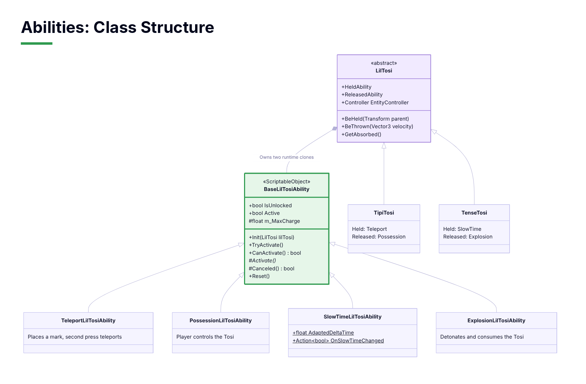
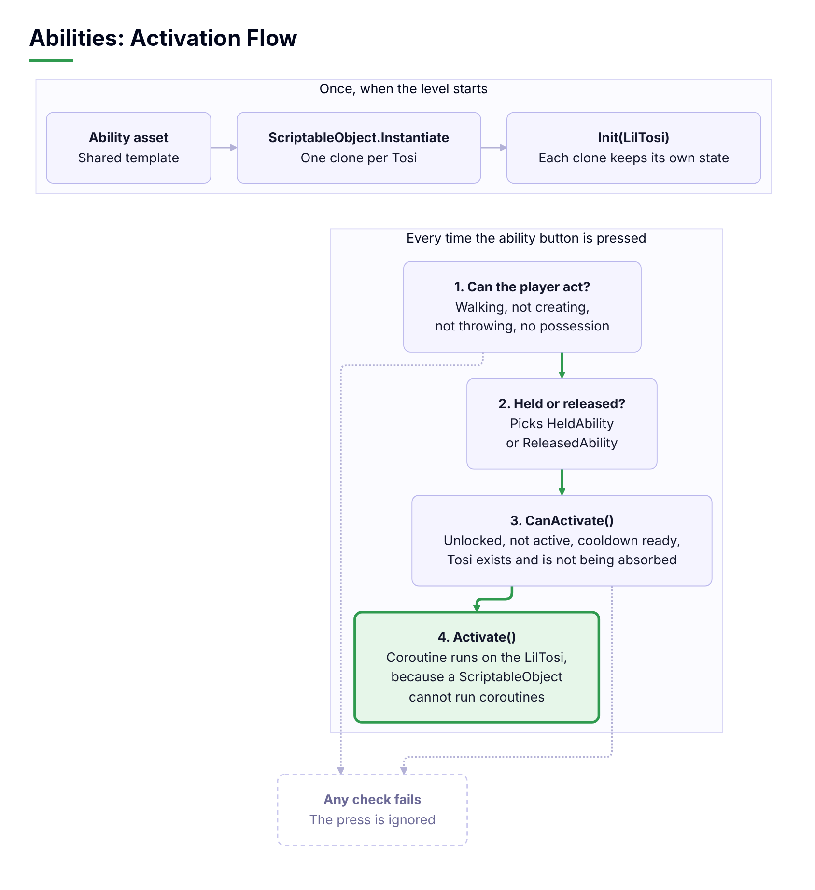
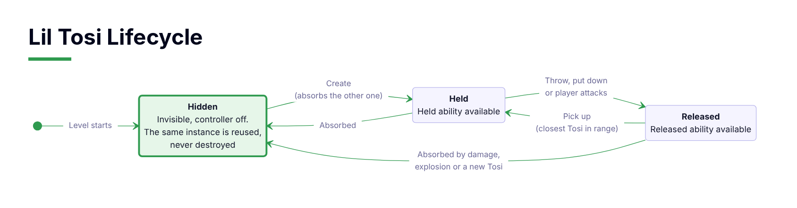
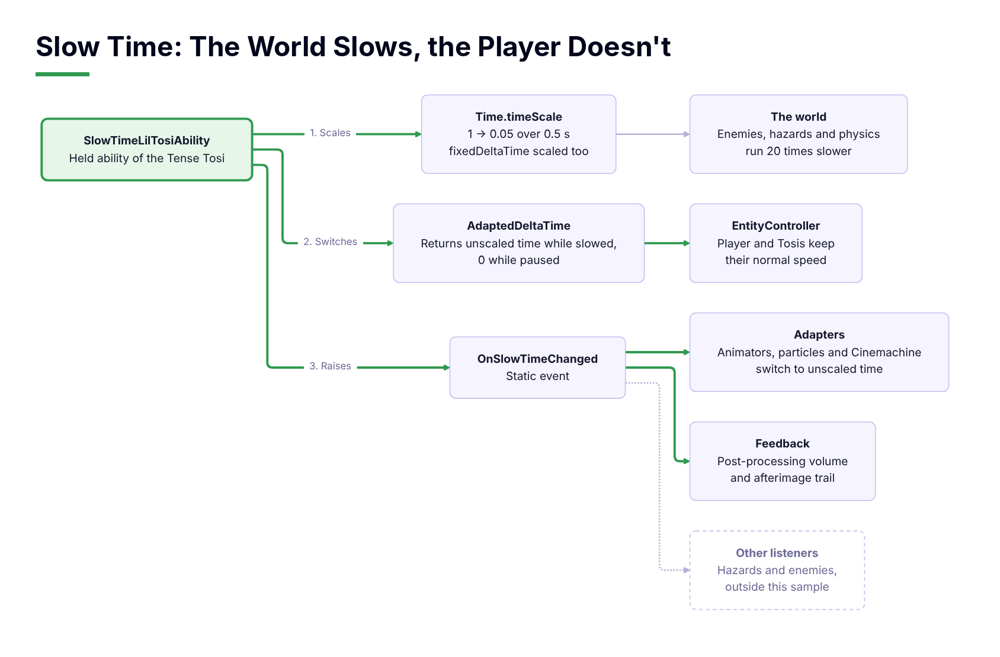

# Abilities and Companions

<!-- TODO: GIF of creating, throwing and using a Lil Tosi -->

In My Tosis the player can create two small companions, the Lil Tosis: Tipi and Tense. Only one exists at a time. The player can carry it, throw it, pick it up again or absorb it, and each Tosi has two abilities: one for when the player is holding it and one for when it has been released.

| Tosi | While held | Once released |
|---|---|---|
| Tipi | **Teleport**: place a mark, press again to return to it | **Possession**: control the Tosi for up to 11 seconds |
| Tense | **Slow Time**: slow the world down for up to 6.5 seconds | **Explosion**: detonate the Tosi |

The split came from design. Held abilities make the player keep the Tosi close, and released ones let them act from a distance.

## Architecture

<picture>
  <source media="(prefers-color-scheme: dark)" srcset="Diagrams/class-structure-dark.png">
  
</picture>

Abilities are ScriptableObjects. The goal was to let designers create and tune abilities as assets instead of code, and to keep each ability separate from the Tosi that uses it, so they could be swapped later if the design asked for it.

### Why each Tosi clones its abilities

The first version used the ability assets directly, and it broke in two ways: the Tosis changed each other's ability state, and values changed during play mode stayed in the assets afterwards. A ScriptableObject asset is shared by everything that references it, so any runtime state stored in it is shared too.

The quick fix was `ScriptableObject.Instantiate` in `LilTosi.Start`, which gives each Tosi its own copy. It works, but today I would keep the asset for configuration only and move the runtime state (charge, active flag) into a plain C# class owned by the Tosi.

## How an ability runs

<picture>
  <source media="(prefers-color-scheme: dark)" srcset="Diagrams/activation-flow-dark.png">
  
</picture>

A ScriptableObject cannot run coroutines, which I found out while building this. `BaseLilTosiAbility` forwards `StartCoroutine` to the `LilTosi` that owns it, so each ability can still be written as a coroutine.

**Charge.** Each ability has a charge (`m_Charge` out of `m_MaxCharge`) that the UI shows as a bar, and it has to be full to activate.

- **Slow Time** drains it while active and refills it over 2 seconds afterwards.
- **Possession** also drains it while active, and is blocked for 1.2 seconds after it ends.
- **Teleport** and **Explosion** have a maximum of 0. Teleport has no cooldown, and Explosion consumes the Tosi anyway.

In the game this value was called "time liquid". I renamed it here because the old name hid what it does.

**Static events.** Ability events are static (`OnStartPossession`, `OnSlowTimeChanged`...), so the camera, the player rotation and the time adapters can react without a reference to a specific Tosi. It was the simplest option, and the design already guaranteed that only one possession could happen at a time.

## Companions

<picture>
  <source media="(prefers-color-scheme: dark)" srcset="Diagrams/lil-tosi-lifecycle-dark.png">
  
</picture>

Only one Tosi can exist at a time, and creating one absorbs the other. It started as a design rule and made the implementation simpler: both Tosis are in the scene from the start, under `LilTosiPack`, and they are hidden, shown and moved around. They are never instantiated or destroyed.

The Tosis move with the same `EntityController` as the player. Throwing them with a Rigidbody made it hard to know where they would land. With the controller, gravity and collisions are under control, so `LilTosiThrower` can simulate the same parabola to draw the aiming line and find the landing point.

## Time scale

<picture>
  <source media="(prefers-color-scheme: dark)" srcset="Diagrams/slow-time-dark.png">
  
</picture>

Slow Time is the held ability of Tense, inspired by the Flash: the player moves so fast that the world seems to stop. It brings `Time.timeScale` down to 0.05 over half a second and scales `fixedDeltaTime` with it, so the world runs 20 times slower.

The `EntityController` reads `AdaptedDeltaTime`, which returns unscaled time while the effect is on. The player and the Tosis keep their normal speed, since Tense is meant to be a fast Tosi too. Small adapter components switch Animators, particles and the Cinemachine brain to unscaled time on the objects that should ignore the effect, and pause always takes priority. A post-processing volume and an afterimage trail make the effect visible.

None of this was planned as a separate system. It grew out of the Slow Time ability, which is why `AdaptedDeltaTime` still lives inside `SlowTimeLilTosiAbility`.

## Key files

- [`Abilities/BaseLilTosiAbility.cs`](Abilities/BaseLilTosiAbility.cs): the base class and the activation checks.
- [`Abilities/SlowTimeLilTosiAbility.cs`](Abilities/SlowTimeLilTosiAbility.cs): slow motion and `AdaptedDeltaTime`.
- [`Companions/LilTosi.cs`](Companions/LilTosi.cs): cloning the abilities, being held, thrown and absorbed.
- [`Companions/LilTosiThrower.cs`](Companions/LilTosiThrower.cs): picking up the closest Tosi and the trajectory preview.

## Known limitations and what I would change

- **Runtime state in ScriptableObjects.** Cloning works, but separating configuration from runtime state would be cleaner.
- **Possession duplicates movement.** It has its own movement and jump code instead of reusing the player's components. It only needed moving and jumping, and the player FSM was tuned for the player's feel, so writing it separately was faster. Its jump is floatier, which is why it got coyote time and the player's jump did not. The result is two versions of similar code.
- **Time handling inside an ability.** `AdaptedDeltaTime` should live in its own small service that the controller and the ability both use.
- **Static flags.** `PossessionLilTosiAbility.IsActivated` and `PossessedLilTosi` are static, which only works because there is never more than one possession.
- **Too much structure too early.** Trying to make everything perfect from the start built structure that sometimes got in the way. What I took from it is knowing when a complex system is worth it and when it is not. The `EntityController` was worth it, since the companions reused it as it was.
