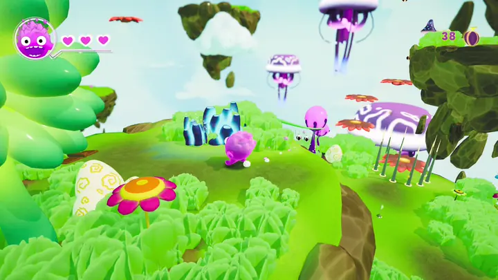
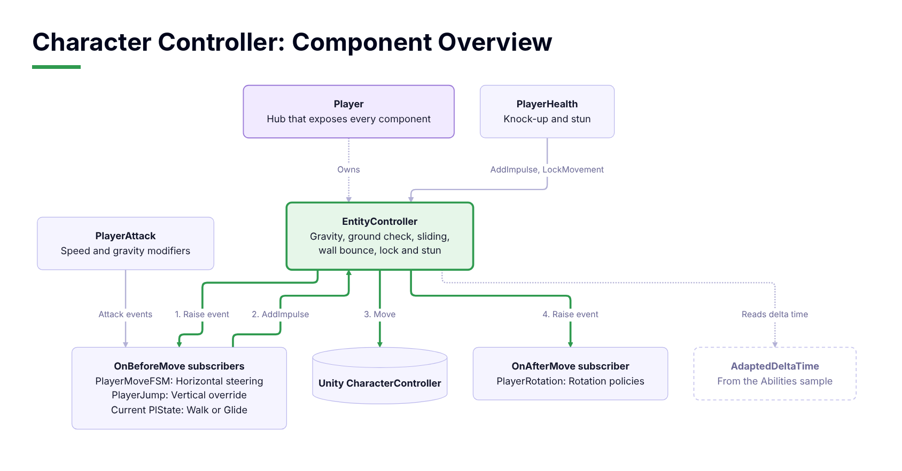
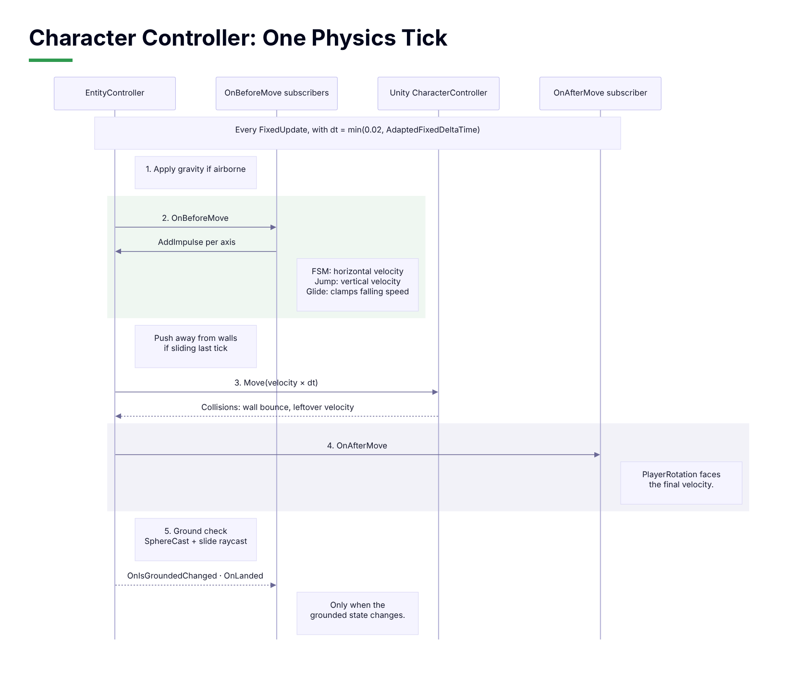
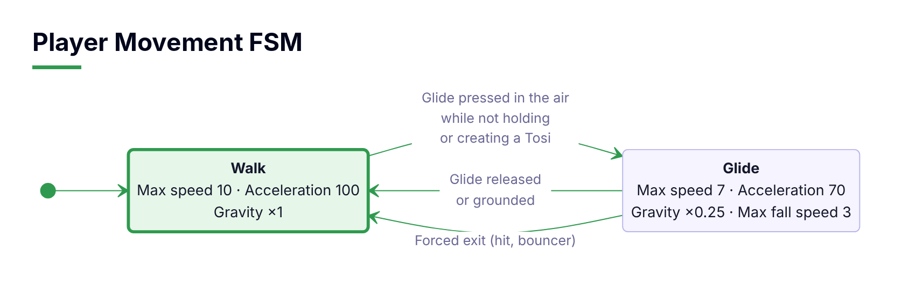

# Character Controller

  

The player movement in My Tosis: walking, a double jump, gliding and a basic attack. It runs on a kinematic controller I wrote on top of Unity's `CharacterController`, without a Rigidbody.

## Why a custom controller

I had two reasons. The first was to learn what a controller with simulated physics actually needs: gravity, ground checks, slopes, collisions. The second was feel. A platformer feels better when its physics are not realistic, and I preferred building that from scratch to fighting a Rigidbody into it. In the game, gravity on the player is -50, about five times Earth's.

It also meant that nothing in the level could push the player unless the code allowed it, which avoided a whole class of physics bugs.

## Architecture

<picture>
  <source media="(prefers-color-scheme: dark)" srcset="Diagrams/component-overview-dark.png">
  
</picture>

`Player` keeps a reference to every component, so any of them can reach the others (`m_Player.Controller`, `m_Player.Jump`...). The `EntityController` owns the velocity. Components never move the transform themselves: they call `AddImpulse(velocity, overrideHorizontal, overrideVertical)`.

Overriding per axis is what lets the systems work together. The jump replaces the vertical velocity without touching the horizontal velocity that `PlayerMoveFSM` just computed, and a hit can replace both.

## The physics tick

<picture>
  <source media="(prefers-color-scheme: dark)" srcset="Diagrams/physics-tick-dark.png">
  
</picture>

Every `FixedUpdate` the controller applies gravity, raises `OnBeforeMove`, moves, raises `OnAfterMove` and checks the ground.

There are two events instead of one because some systems need the state before the move and others after it. `PlayerRotation` turns the character towards its final velocity, after collisions and wall bounces, so it listens to `OnAfterMove`. `PlState` also exposes an `OnAfterMove` hook that no state ended up using.

The delta time is capped at 0.02 s, the default fixed step. If the time scale code ever returns a larger value, the controller still never takes a step big enough to go through a wall.

**Walls and edges.** In early versions the character got stuck on walls. Now, when it hits a wall in the air, the controller keeps the part of the velocity that runs along the wall, so the character slides instead of sticking. On the ground it adds a small bounce away from the wall. The angle limits for that bounce (below 30° or above 50°) started as placeholders and were tuned by feel. When the character is touching the ground but the ground check fails, a short raycast tells whether it is standing on an edge, and if so it is pushed off.

## Movement states

<picture>
  <source media="(prefers-color-scheme: dark)" srcset="Diagrams/movement-fsm-dark.png">
  
</picture>

Each state is a `MonoBehaviour` that extends `PlState`, with its own maximum speed, acceleration and gravity multiplier. A state decides when it can be entered (`CanEnterState`) and left (`CanExitState`), and the list of states it can move to is set in the Inspector, so transitions change without touching code.

With only Walk and Glide in the final game, that was more than it needed. I built it this way to practise making an FSM editable from the editor. A third state, BallRun, was planned (low acceleration and a lot of sliding, inspired by the ball run in Psychonauts) and later cut. Its class is still here with the entry condition disabled.

`PlayerMoveFSM` turns input into acceleration: the difference between the desired and the current velocity, clamped by the acceleration of the active state. While attacking, `PlayerAttack` scales the speed and gravity through events.

## Rotation policies

`PlayerRotation` decides where the character faces through a small set of policies:

| Policy | The character faces | Used |
|---|---|---|
| `NONE` | Does not rotate | While possessing a Tosi |
| `LWYG` (look where you go) | Its horizontal velocity, keeping its facing if there is no input during a lock | After throwing and after a possession ends |
| `LAC` (look at camera) | The camera's forward direction | While aiming a throw |
| `LAI` (look at input) | The input direction | Starting policy in the game, and after a bounce |
| `LWYM` (look where you move) | Its horizontal velocity, always | During the glide cinematic |

`SetPolicyDuringTime` locks a policy for a short time. A bouncer, for example, forces `LWYG` for one second and then switches to `LAI`.

## Key files

- [`EntityController.cs`](EntityController.cs): gravity, ground and edge checks, wall bounce, movement lock.
- [`MovementStates/PlState.cs`](MovementStates/PlState.cs) and [`MovementStates/PlayerMoveFSM.cs`](MovementStates/PlayerMoveFSM.cs): the movement FSM.
- [`Player/PlayerJump.cs`](Player/PlayerJump.cs): double jump with an input buffer.
- [`Player/PlayerAttackBehaviour.cs`](Player/PlayerAttackBehaviour.cs): the attack hit window, driven by the animation's normalized time.

## Known limitations and what I would change

- **Slopes.** Sliding down slopes still has bugs. The ground and edge checks are the first thing I would rework.
- **The `Player` hub.** Every component goes through `Player` to find the others, which ties them all to one class. Today I would let each component reference only what it needs.
- **Execution order.** The order between these scripts was set in Unity's Script Execution Order by trial and error until everything worked. I would make it explicit instead, with one place that updates the systems in a known order.
- **Time comes from an ability.** The controller reads its delta time from `SlowTimeLilTosiAbility.AdaptedDeltaTime`, so it depends on the Abilities sample. A small time service would remove that dependency.
- **Jump forgiveness.** The jump has an input buffer, set to 0 in the game, and no coyote time. The Possession ability, written later, has both.
