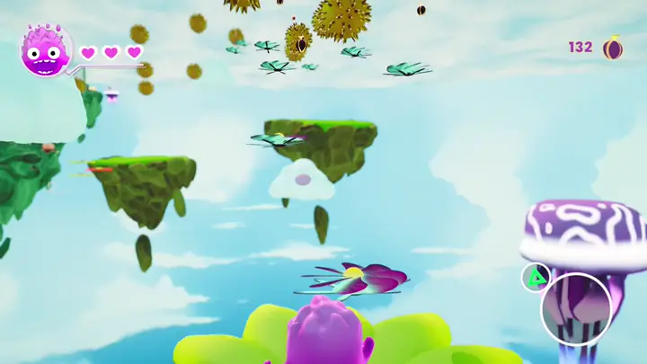

# My Tosis: Gameplay Programming Samples

Code samples from **My Tosis: A Life Mission**, a 3D platformer with puzzle elements made in Unity by a team of 7 in about three months. I was a gameplay programmer on the project: I wrote the player controller, the ability system, the companions and many of the level elements.

This is a selection of that code, not the full project, and it will not compile on its own. [What is not included](#what-is-not-included) lists everything it depends on.

  

<!-- TODO: links to the itch.io page and the full gameplay video -->

## The samples

| Sample | What it shows |
|---|---|
| [Character Controller](CharacterController/) | A kinematic controller built on top of Unity's `CharacterController`, a movement FSM where each state is a component, and player components that talk through events instead of calling each other. |
| [Abilities and Companions](AbilitiesAndCompanions/) | Abilities as ScriptableObjects cloned at runtime, the Lil Tosi companions the player creates, throws and absorbs, and a slow motion ability that slows the world but not the player. |

## Start here

If you only have a few minutes, these are the files I would open first:

1. [`EntityController.cs`](CharacterController/EntityController.cs): the controller that moves both the player and the companions.
2. [`PlState.cs`](CharacterController/MovementStates/PlState.cs) and [`PlayerMoveFSM.cs`](CharacterController/MovementStates/PlayerMoveFSM.cs): movement states as components, with their transitions set in the Inspector.
3. [`BaseLilTosiAbility.cs`](AbilitiesAndCompanions/Abilities/BaseLilTosiAbility.cs): the base class every ability extends.
4. [`SlowTimeLilTosiAbility.cs`](AbilitiesAndCompanions/Abilities/SlowTimeLilTosiAbility.cs): slow motion, and the time handling the rest of the code relies on.

## Some context

My Tosis was a short project and I used it to try things out. Several systems are more flexible than the final game needed: abilities defined as assets, FSM transitions editable from the Inspector, two separate move events where one might have been enough. Not all of it paid off, and some of that structure got in the way more than it helped.

The `EntityController` is the case where it did pay off. I wrote it for the player, and later the companions used it as it was, like any other Unity component. Each sample's README says which decisions I would keep and which I would change today.

## What is not included

The samples call code that is not in this repository, either because other people on the team wrote it or because it falls outside these two samples. Those calls are left exactly as they were in the game.

| Dependency | What the samples use it for |
|---|---|
| `GameManagerStateMachine` | Global game state: pause flag, static game data, input asset, unlocked Tosis |
| `IPaused` | Interface the time adapters implement to react to pause |
| `DynamicGameData` | Runtime game data, such as which Tosis are unlocked |
| `LevelManager` | Registers objects that reset on death and holds the respawn point |
| `TimerManager`, `Timer` | Delayed callbacks |
| `Singleton<T>` | Base class for `Player` and `LilTosiPack` |
| `GameUIManager` | Hearts and ability UI |
| `RumbleManager` | Controller vibration |
| `CinemachineCameraShaker`, `CinemachineCameraSwitcher` | Camera shake while gliding, camera changes on possession and respawn |
| `MeshHider` | Shows and hides character meshes |
| `Bouncer` | Level obstacle whose bounce event `PlayerAnimation` listens to |

Packages: Cinemachine, FMOD for Unity, Unity Input System and TextMeshPro.

## Code conventions

These are the conventions I used in the game, applied the same way across every file here:

- `m_` prefix for fields, `l_` for local variables, no prefix for parameters.
- Serialized fields are private and marked `[SerializeField]`.
- Inspector fields are grouped with headers like `[Header("========== JUMP RELATED PROPERTIES ==========")]`.
- C# events (`Action`) for code that listens, `UnityEvent` for hooks set up in the Inspector. Both are named `On...`.

## Known issue in shared code

`UtilsMethods.ReturnRepeatChild` stores its result in a static field that is never cleared. If the child is not found, it can return the one found in an earlier search. Fixing it means restructuring the function, so I left it as it is and documented it here.

## Repository history

The history is split into small commits so every change can be checked on its own:

1. The original scripts, copied without changes and kept at their original paths.
2. Files moved into one folder per sample. No content changes.
3. Naming normalization (listed below).
4. Four bug fixes, one commit each, with the explanation in the commit message.
5. Removal of one helper whose authorship I could not confirm.
6. The last methods still using an old name, renamed.
7. This documentation and the diagrams.
8. The gameplay clips.

## About this repository

All the code in this repository was written by me during the development of My Tosis.

I used Claude (Anthropic) to help choose the samples, organize the folders, write this documentation, draw the diagrams and pick and encode the gameplay clips. The changes made to the code itself are only these:

- **Renamed identifiers.** Typos fixed (`TenseExplisionHit`, `m_GetAbsorvedDelay`, `DeatachLilTosi`, `GetDirecton`, `m_KockUpForce` and a few more), "time liquid" renamed to "charge", and missing `m_` and `l_` prefixes added. Renamed serialized fields keep their saved values through `[FormerlySerializedAs]`.
- **Field visibility.** Twelve public fields made private with `[SerializeField]`.
- **Comments.** Three comments translated from Catalan and Spanish to English.
- **Leftovers removed.** Commented-out code and debug logs.
- **Bug fixes.** Four, each in its own commit.
- **One helper removed** (`Shuffle`), because I am not sure I wrote it.

No method was rewritten, reordered or restructured to make it easier to read. The first commit keeps every file exactly as it was in the game, so anything here can be compared against the original.
